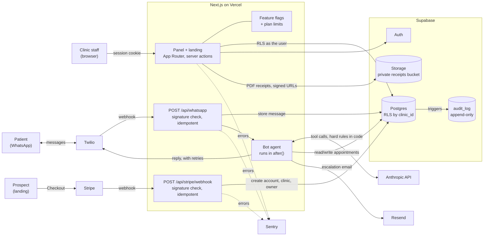

# CitaBot Dental (open-crm)

[](https://github.com/allinamosnola/open-crm/actions/workflows/ci.yml)

Multi-clinic SaaS for dental practices: a web panel (Next.js + Supabase) for scheduling, patients,
treatment plans, payments and WhatsApp conversations, plus a Claude-powered bot that books, cancels
and reschedules appointments and hands anything it cannot resolve to the front desk.

The full documentation is in Spanish in [README.md](README.md). This page is a short technical summary.

## Stack

- **App:** Next.js (App Router) + React 19 + TypeScript (strict) + Tailwind, deployed on Vercel.
- **Data:** Postgres on Supabase: SQL migrations, Row Level Security keyed by `clinic_id`, Auth
  (invitations, password recovery), pgTAP tests in `supabase/tests`.
- **Billing:** Stripe subscriptions (Checkout, Customer Portal, plan changes with proration) and an
  idempotent webhook that provisions the account, clinic and owner after payment.
- **Messaging:** Twilio WhatsApp (signed webhooks, idempotent by `MessageSid`) and Resend for email alerts.
- **AI:** tool-using agent on the Anthropic API; hard business rules (opening hours, 24 h policy,
  offered slots) are enforced in code, not in the prompt. `npm run eval:bot` runs an eval against the real model.
- **Observability:** Sentry with PII scrubbing.

## Architecture



Key decisions:

- **Tenant isolation lives in the database.** Every business table carries `clinic_id` and is protected by
  RLS; the service role is used only in webhooks and scripts, never in the browser.
- **Webhooks are idempotent** (`MessageSid` for Twilio, event/session ids for Stripe), so provider retries are safe.
- **The model proposes, code decides.** Opening hours, the 24 h cancellation policy and offered slots are validated
  in code; the prompt is not a security boundary.
- **Outbound calls retry only when safe** (`src/lib/retry.ts`): Twilio timeouts are not retried to avoid
  duplicating a WhatsApp message; failed messages can be resent manually.
- **New capabilities ship behind flags** (`feature_flags`, global or per account), e.g. PDF documents.

## Run the tests

```bash
npm ci
npm run lint && npx tsc --noEmit
npm test                      # vitest: server project (bot, Stripe, WhatsApp) + components project (jsdom)
npx supabase start && npx supabase test db   # pgTAP (RLS, plan limits)
npx playwright install chromium && npm run e2e   # Playwright E2E against the seeded local DB
```

E2E flows: sign-in and tenant isolation, creating a patient and an appointment, the inbox fed
by a simulated Twilio webhook with a valid signature, the Basic plan lock and the landing
checkout up to the point that needs Stripe. The test server gets no Stripe, Twilio REST,
Anthropic or Resend credentials, so nothing leaves the machine. CI runs lint, typecheck,
vitest, build, pgTAP and E2E (traces uploaded as artifacts) on every PR.

## Roadmap

Work in this repository follows [docs/plans/](docs/plans/) (plans are timestamped and logged in its README).
The current one is `2026-10-12_1748_brecha-puesto-valsnapp.md`: CI, component and E2E tests, retries
for third-party APIs, feature flags, Storage + PDF receipts, and audit logging.

## License

MIT, see [LICENSE](LICENSE).
